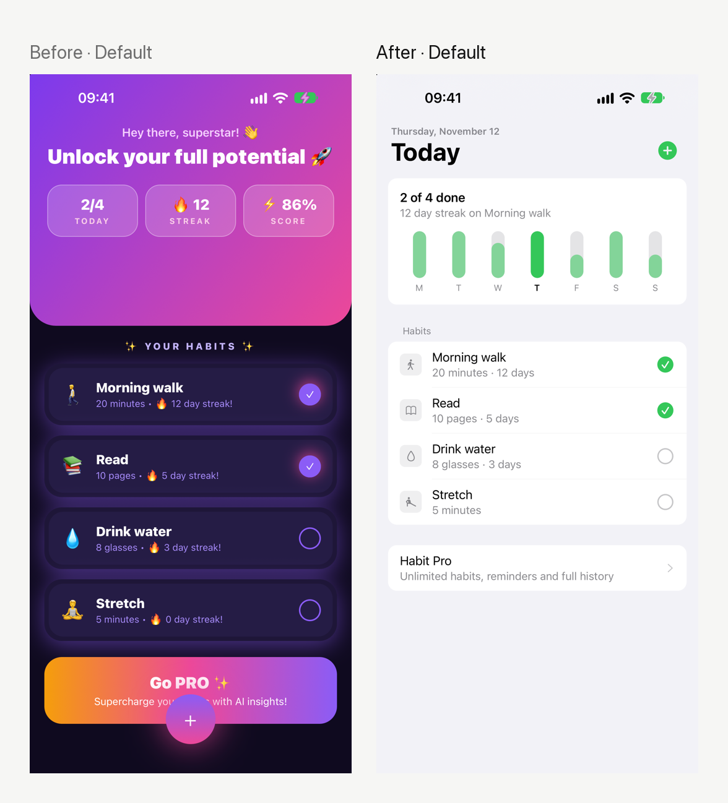
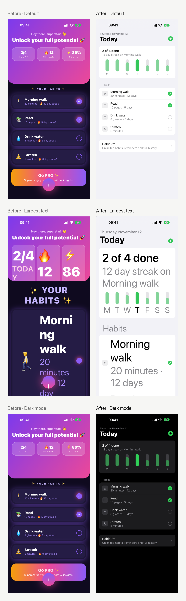

# nativize

Make a vibecoded mobile app look and feel like a real iOS or Android app.

nativize is an agent skill for Claude Code, Codex and other coding agents. It finds the tells that make a React Native, Expo or SwiftUI screen look AI-made, fixes them pass by pass using the platform's own design system, and proves the result with before and after simulator screenshots.



Same content, same features. Left: what a model writes when you ask for "a beautiful habit tracker". Right: the same screen after one nativize pass. Both are real simulator captures of the app in [`examples/habit-demo`](examples/habit-demo).

## Why

This year I built a dozen small iOS apps, most of them with an AI coding assistant. The code was fine. The first drafts of the screens all failed the same way: they looked AI-made. Gradient headers, cards inside cards, emoji labels, glowing buttons, font sizes typed in by feel, a paywall that reads like an ad. A few of these are not only taste: App Review checks paywalls, and a welcome screen whose button gets pushed off screen at a large text size is a bug real users hit.

None of it is hard to fix once you can name it. nativize names it and fixes it.

## What it does

1. **Scans** the project for code-level tells and gives a score (see below).
2. **Captures** the screen in three conditions: default, the largest accessibility text size, and dark mode.
3. **Sets a direction** from the product's category, one accent color and one memorable moment.
4. **Fixes in passes**: platform fit, layout and reach, type, color, icons, components, touch and feedback, copy, motion, then onboarding and paywall rules that App Review checks.
5. **Proves it** with after captures and a side by side image.



## Install

Claude Code:

```bash
git clone https://github.com/Metehan-Bicer/nativize
mkdir -p ~/.claude/skills && cp -r nativize/skills/nativize ~/.claude/skills/
```

Codex and other agents that read `~/.agents/skills`:

```bash
git clone https://github.com/Metehan-Bicer/nativize
mkdir -p ~/.agents/skills && cp -r nativize/skills/nativize ~/.agents/skills/
```

For a single project, copy `skills/nativize` into that project's `.claude/skills/` or `.agents/skills/` instead.

Then ask your agent: *"nativize the home screen"*, *"this screen looks AI-made, fix it"*, or *"check the paywall before I submit"*.

## The scanner

`scan.mjs` has no dependencies and runs on Node 18 or newer. Use it on its own or in CI.

```bash
node skills/nativize/scripts/scan.mjs path/to/your-app
node skills/nativize/scripts/scan.mjs path/to/your-app --json
node skills/nativize/scripts/scan.mjs path/to/your-app --min-score 80   # exits 1 below 80
```

```text
nativize scan  examples/habit-demo/src/BeforeHome.tsx
1 UI files, 26 findings, score 8/100

[high] Gradient used on chrome (3)
[high] Font scaling turned off (2)
[medium] Default AI purple, violet or pink (5)
[medium] Emoji used as UI text or icon (5)
[medium] Font size off the platform type ramp (3)
[medium] Colored glow shadow (3)
[medium] Marketing voice inside the app (2)
[medium] Dark mode not handled (1)
...
```

Each finding comes with the file, the line and a fix. The full output is in [docs/scan-before.txt](docs/scan-before.txt); the after screen scores 100.

The scanner catches what code can show. Spacing, hierarchy and whether a screen has any character at all need the skill and a pair of eyes, which is why the skill always ends with screenshots.

### What it looks for

| Tell | Stacks |
| --- | --- |
| Gradients on headers, buttons and tab bars | RN, SwiftUI |
| The default AI purple, violet and pink | RN, SwiftUI |
| Font scaling turned off or Dynamic Type locked | RN, SwiftUI |
| Font sizes off the platform type ramp, and many sizes typed in by hand | RN, SwiftUI |
| Emoji used as icons or labels | RN, SwiftUI |
| Colored glow shadows, and shadows on everything | RN, SwiftUI |
| Layouts sized for one phone | RN, SwiftUI |
| Custom tab bars and custom back buttons | RN, SwiftUI |
| Tappable views without pressed feedback | RN, SwiftUI |
| Marketing voice inside the app | RN, SwiftUI |
| Looping animations in the chrome | RN, SwiftUI |
| All caps tracked labels | RN, SwiftUI |
| Inline colors and no dark mode handling | RN, SwiftUI |

## Screenshots

With an iOS simulator booted (or an Android emulator connected) and your app on the screen you want to fix:

```bash
skills/nativize/scripts/capture.sh before
# ...make the changes...
skills/nativize/scripts/capture.sh after
python3 skills/nativize/scripts/compare.py nativize-shots/before nativize-shots/after
```

`capture.sh` switches text size and appearance, takes the shots and puts your settings back. `compare.py` needs Pillow; without it, it writes an HTML page instead.

## What's inside

```
skills/nativize/
  SKILL.md                      the workflow the agent follows
  references/tells.md           what AI-made mobile screens get wrong
  references/platform.md        tap targets, spacing, type ramps, colors
  references/react-native.md    fixes for React Native and Expo
  references/swiftui.md         fixes for SwiftUI
  references/onboarding-paywall.md   design plus App Review rules
  scripts/scan.mjs              the scanner
  scripts/capture.sh            simulator and emulator screenshots
  scripts/compare.py            before and after image
```

## Roadmap

- Flutter and Jetpack Compose.
- Android captures in the demo.
- More rules from real projects. If the scanner misses a tell or flags something that is fine, please open an issue with the snippet.

## Credits

The idea of treating "AI-looking UI" as a list of nameable tells comes from [unslop](https://github.com/heydamir/unslop) by Damir Sokolovsky, which does this for web interfaces. nativize is a separate project for mobile and shares no text or code with it.

I built nativize with heavy help from an AI coding assistant and reviewed and tested everything. The rules come from shipping my own apps.

## License

MIT
